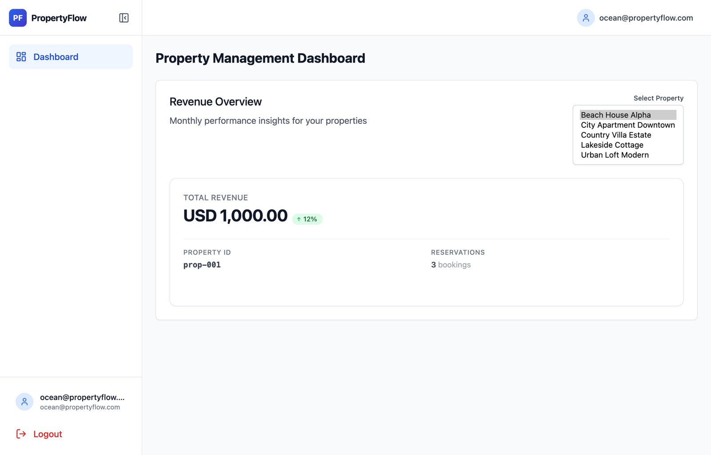
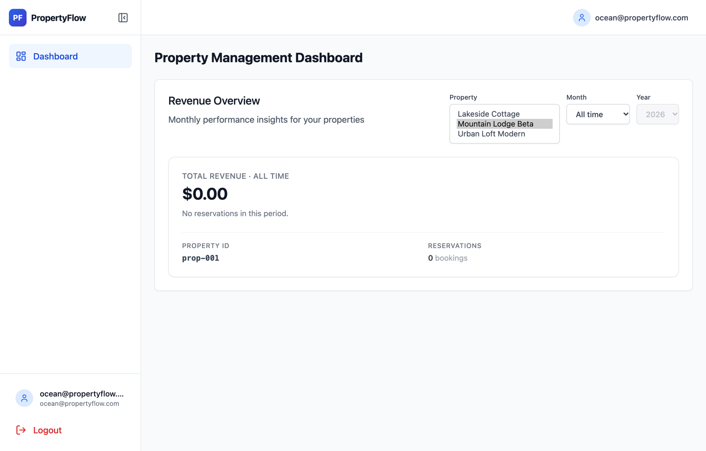
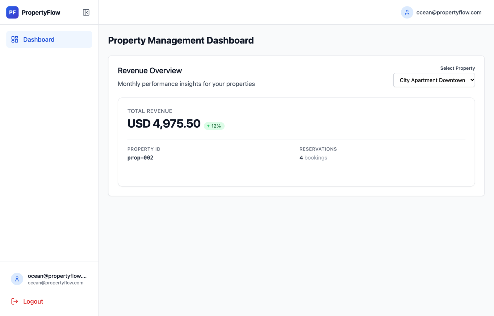
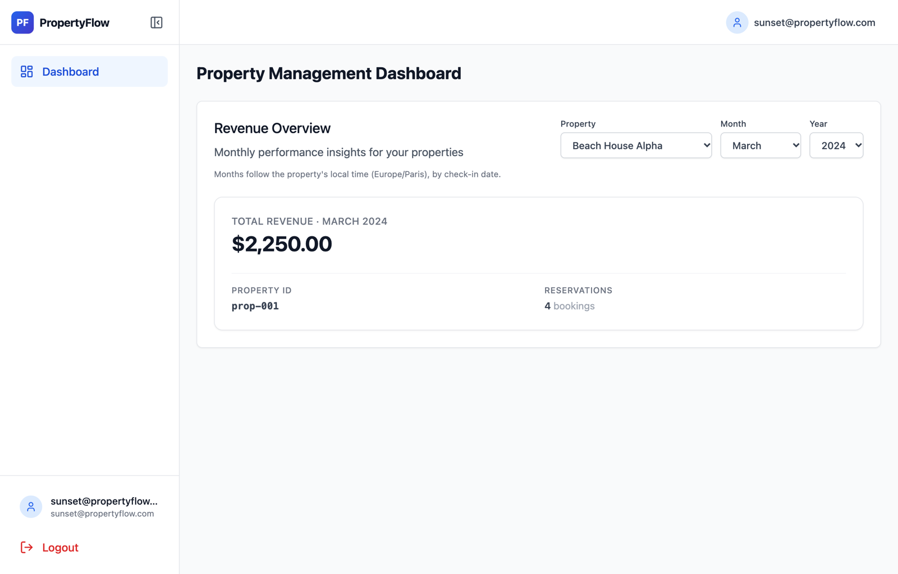
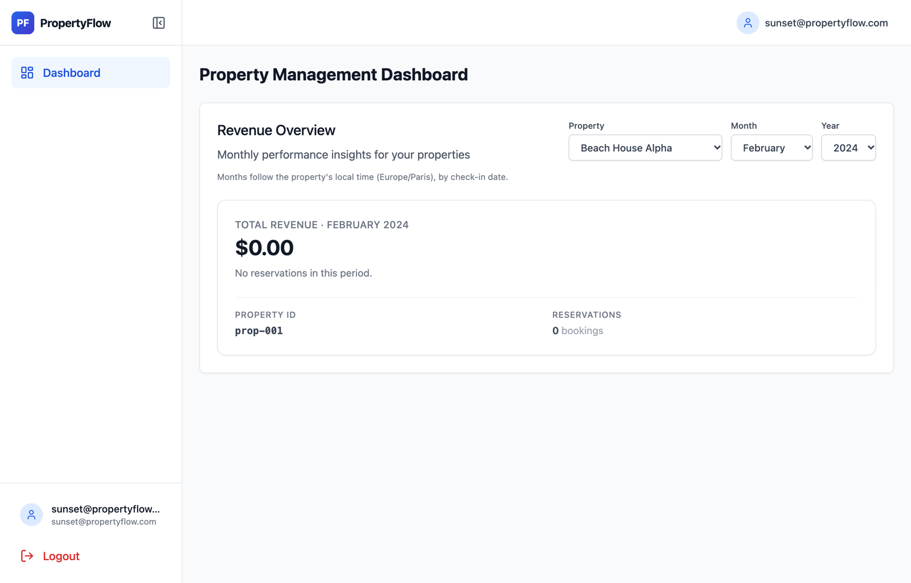

# Property Revenue Dashboard: Bug Investigation & Fixes

**Loom walkthrough:** _LOOM_LINK_

Three reported issues (two from clients, Sunset Properties and Ocean Rentals, and one from our finance team), one root-cause chain. The dashboard never read the database. It served hard-coded mock numbers keyed only by property ID, behind a Redis cache keyed only by property ID. Property IDs are only unique **per tenant** (`prop-001` exists for both clients). Month boundaries were naive UTC, and money went through `float`.

| # | Report | Root cause | Fix |
|---|--------|-----------|-----|
| 1 | **Ocean Rentals sees another company's revenue** (privacy) | Cache key `revenue:{property_id}` had no tenant. The mock fallback ignored the tenant. Nothing checked that the property belongs to the caller. The UI hard-coded every tenant's properties. | Tenant in every cache key and every query. 404 for properties the caller doesn't own. Property list loaded from a tenant-scoped endpoint. |
| 2 | **Sunset's March totals don't match** | Mock/UTC numbers: the DB was never queried, and month boundaries ignored the property's time zone. `res-tz-1` checks in at `2024-02-29 23:30Z`, which is **1 March 00:30 in Paris**. | Working DB pool, real queries. Month boundaries computed in the property's IANA time zone and converted to UTC. |
| 3 | **Totals off by a few cents** | Amounts stored at 3 decimals (`NUMERIC(10,3)`), converted to `float` in the API, and rounded again with `Math.round(x*100)/100` in the UI (e.g. `1.005 → 1.00`). | Exact `NUMERIC` sum in Postgres, rounded **once**, half-up, to cents with `Decimal`. Sent as a decimal string (`"2250.00"`). No float maths in the UI. |

| + | **Found while investigating: revenue readable without credentials** | Auth fallback accepted the literal `mock-token-123` and **unsigned** JWTs. Login issued tokens for mock emails **with any password**. | No unverified fallback, 401 for unverified logins, regression tests. |

Correct figures (all bookings in the seed are March 2024, local time):

| Client | Property | Before (UI) | After | Bookings |
|---|---|---|---|---|
| Sunset | Beach House Alpha (`prop-001`) | 1,000.00 (3) | **2,250.00** | 4 |
| Sunset | City Apartment Downtown (`prop-002`) | 4,975.50 | 4,975.50 | 4 |
| Sunset | Country Villa Estate (`prop-003`) | 6,100.50 | 6,100.50 | 2 |
| Ocean | Mountain Lodge Beta (`prop-001`) | 1,000.00 (**Sunset's data**) | **0.00** | 0 |
| Ocean | Lakeside Cottage (`prop-004`) | 1,776.50 | 1,776.50 | 4 |
| Ocean | Urban Loft Modern (`prop-005`) | 3,256.00 | 3,256.00 | 3 |

---

## Run & test

```bash
docker compose up --build        # frontend http://localhost:3000, API docs http://localhost:8000/docs
make test                         # backend pytest suite inside the running backend container
```

Logins: `sunset@propertyflow.com` / `client_a_2024`, `ocean@propertyflow.com` / `client_b_2024`.

---

## How I investigated

1. Logged in as each client and called `GET /api/v1/dashboard/summary` directly with each token.
   - Ocean's `prop-001` returned `1000.0` with 3 bookings, even with an empty cache.
   - Ocean could also read Sunset's `prop-002` (`4975.5`).
2. The backend logs showed these two lines on **every** request. Every number on the dashboard was mock data:
   ```text
   ERROR:app.core.database_pool:❌ Database pool initialization failed: 'Settings' object has no attribute 'supabase_db_user'
   Database error for prop-001 (tenant: tenant-b): Database pool not available      ← falls into the mock fallback
   ```
3. Redis contained `revenue:prop-001` and `revenue:prop-002`, with no tenant in the key.
4. I compared the dashboard with the source of truth in Postgres: SUM per property, with March computed both in UTC and in the property's local time. Beach House Alpha is **1000.000 in UTC-March but 2250.000 in Paris-March**.

## Findings in detail

### 1. Cross-tenant data leak (Ocean Rentals)
- **`backend/app/services/cache.py`** used the cache key `f"revenue:{property_id}"`. The schema's primary key is `(id, tenant_id)`, so `prop-001` is two different properties. Whichever tenant loaded it first filled the cache for 5 minutes, and the other tenant then saw those numbers. That's why the client said "sometimes, when we refresh".
  - Fix: `revenue:{tenant_id}:{property_id}:{period}`.
- **`backend/app/services/reservations.py`** caught every exception and returned a mock dict keyed by `property_id` only, so the tenant was ignored. Because the DB never connected (finding 2), this leaked Sunset's numbers to Ocean even with an empty cache. It also hid outages behind plausible-looking data.
  - Fix: mock removed. A DB failure is now a **503**.
- **Ownership check:** the summary query is now preceded by `SELECT … FROM properties WHERE id = :id AND tenant_id = :tenant`. The API returns the **same 404** whether the property doesn't exist or belongs to another tenant, so you can't enumerate other tenants' IDs.
- **Fail closed:**
  - `dashboard.py` fell back to `tenant_id = "default_tenant"`, and `TenantResolver` mapped any unknown user to **tenant-a**.
  - Both now return no tenant, and the endpoint answers **403**.
  - The tenant always comes from the verified JWT, never from the client. The UI used to send an `X-Simulated-Tenant` debug header, which the backend ignored; it has been removed.
- **Frontend:** `Dashboard.tsx` hard-coded all five properties for every user. Ocean saw Sunset's properties, and its own `prop-001` was labelled "Beach House Alpha" instead of "Mountain Lodge Beta".
  - Fix: the list now comes from the new `GET /api/v1/dashboard/properties`, which is scoped to the caller's tenant.

| Before: Ocean sees all properties and Sunset's revenue | After: Ocean sees only its own properties |
|---|---|
|  |  |
|  | Sunset's `prop-002` → `404 Property not found` for Ocean |

### 2. The database was never queried
`backend/app/core/database_pool.py` had four independent bugs:
1. It built the URL from `settings.supabase_db_*`, which don't exist (AttributeError, swallowed). `DATABASE_URL` is now used.
2. It used `poolclass=QueuePool`, which SQLAlchemy rejects for async engines. The default `AsyncAdaptedQueuePool` is now used.
3. `get_session()` was an `async def` used as `async with db_pool.get_session()`, which fails on a coroutine. It's now an `@asynccontextmanager`.
4. A new `DatabasePool()` (a new engine) was created **per request**, which would leak connections under load. There's now one module-level pool, created lazily and disposed on shutdown.

The image was also missing `greenlet`, which SQLAlchemy's asyncio mode needs. Fixed with `sqlalchemy[asyncio]` in `requirements.txt`.

### 3. March totals (Sunset Properties): time zones
Revenue is attributed to the month of the **check-in date in the property's local time zone**. `month_bounds_utc(year, month, tz)` builds local midnight on the 1st with `zoneinfo` and converts it to UTC. The query uses a half-open range `check_in_date >= start AND < end`, so a check-in at exactly midnight is counted once.
- Paris, March 2024 = `2024-02-29T23:00Z … 2024-03-31T22:00Z`. The end moves by an hour because of DST on 31 March.
- `res-tz-1` (`2024-02-29 23:30Z`) is therefore in **March**, giving 2,250.00 from 4 bookings, not February.

The dashboard has a month/year picker (default "All time"). The API takes optional `year` and `month` and validates them: both or neither, month 1–12, otherwise 422.

| Before: Sunset, Beach House Alpha | After: March 2024 | After: February 2024 |
|---|---|---|
|  |  |  |

### 4. "Off by a few cents": money precision
- The schema stores sub-cent amounts (`333.333 + 333.333 + 333.334`). Rounding each booking first gives `999.99`, while summing exactly then rounding gives `1000.00`.
- The API did `float(total)`, and the UI did `Math.round(total * 100) / 100`. Binary floats can't represent most decimals, so `1.005 → 1.00` and `2.675 → 2.67`.
- **Fix:**
  - Postgres sums the exact `NUMERIC` values.
  - Python rounds **once** with `Decimal.quantize(Decimal("0.01"), ROUND_HALF_UP)`.
  - The API returns a decimal string, `"total_revenue": "2250.00"`.
  - The UI only formats it with `Intl.NumberFormat`.
- Reservations in different currencies are no longer summed into one number. The API returns 409 instead of silently adding EUR to USD. Before, the currency was hard-coded to `"USD"`.

```text
before  GET /dashboard/summary?property_id=prop-001  →  {"total_revenue": 1000.0, "reservations_count": 3, ...}    (as Ocean!)
after   GET /dashboard/summary?property_id=prop-001  →  {"total_revenue": "0.00", "reservations_count": 0, ...}    (Ocean)
after   GET /dashboard/summary?property_id=prop-001&year=2024&month=3  →  {"total_revenue": "2250.00", "reservations_count": 4, ...}  (Sunset)
```

### 5. Authentication bypasses (found while investigating the privacy report)
An unauthenticated caller could read Sunset's revenue in three ways. Each one returned `2250.00` before the fix:

```bash
curl -H 'Authorization: Bearer mock-token-123' 'localhost:8000/api/v1/dashboard/summary?property_id=prop-001'
curl -H "Authorization: Bearer <JWT with any payload and a fake signature>" ...
curl -X POST localhost:8000/api/v1/auth/login -d '{"email":"candidate@propertyflow.com","password":"anything"}' ...
```

- **Root cause:** without Supabase configured, `authenticate_request` fell back to a mock client whose `get_user` accepted a hard-coded token. It also decoded JWTs with `verify_signature=False`. `/auth/login` looked up any non-demo email in a mock user list and issued a token **without checking the password**. All of these mapped to tenant-a.
- **Fix:**
  - The Supabase fallback only runs when Supabase is really configured.
  - Logins that aren't verified credentials get a **401**.
  - `test_auth_bypass.py` covers each case.

### 6. Smaller fixes found on the way
- **Stale response race in `RevenueSummary.tsx`:** a slow response for a previously selected property could overwrite the current one. Responses for an outdated selection are now ignored.
- **Error never cleared:** after one failed request, the error stayed on screen even after switching property. It's now cleared on each new request.
- **Fake trend badge removed:** the UI showed a hard-coded "↑ 12%" badge (the code comment said "Fake trend indicator for premium feel"). Fabricated numbers don't belong on a financial dashboard.
- **Redis outage or corrupt cache entry:** the cache now degrades to an uncached DB read instead of failing the request.
- **Edge cases:**
  - A NULL `currency` counts as the default currency, so it no longer triggers a false "mixed currency" 409.
  - An invalid stored time zone returns a clear error instead of an unhandled 500.
- **Year picker:** it defaults to the most recent year with bookings, so picking "March" doesn't land on an empty year.
- Added loading, empty ("No reservations in this period") and error states, and a layout that works on narrow screens.

## API (changed endpoints)

| Endpoint | Response | Errors |
|---|---|---|
| `GET /api/v1/dashboard/properties` | `[{ "id", "name", "timezone", "latest_booking_year" }]` for the caller's tenant | 401, 403 no tenant, 503 |
| `GET /api/v1/dashboard/summary?property_id=&year=&month=` | `{ "property_id", "total_revenue": "2250.00", "currency", "reservations_count", "year", "month" }` | 401, 403, 404 not yours, 409 mixed currency, 422 bad period, 503 DB down |

## Tests (`backend/tests`, 24 tests, `make test`)
- `test_reservations.py`:
  - Paris and New York month bounds across DST
  - December roll-over
  - `res-tz-1` lands in March
  - half-up rounding cases (`1.005`, `2.675`, sub-cent sums)
- `test_revenue_cache.py`:
  - the same `prop-001` for two tenants never shares a cache entry
  - cache hits
  - key format
  - Redis outage fallback
- `test_dashboard_api.py`:
  - tenant comes from the token
  - money is a string
  - 404 for another tenant's property
  - 403 without tenant
  - 422 for invalid periods
  - 503 when the DB is down (no mock numbers)
- `test_auth_bypass.py`:
  - mock token rejected
  - forged unsigned JWT rejected
  - wrong password rejected
  - valid login gets its own tenant
- `test_revenue_db_integration.py`: runs against the seeded Postgres and asserts:
  - the real March/February totals
  - tenant isolation
  - tenant-scoped property lists

  It's skipped only when no DB is reachable; SQL errors fail it.

## Assumptions
- **Revenue is attributed to the check-in month** in the property's local time. This matches the existing query in the original code. Splitting a stay across months by night is a product decision; see below.
- "All time" is the default view. Monthly figures are opt-in via the picker.
- Sub-cent storage (`NUMERIC(10,3)`) was kept. It's intentional ("sub-cent precision tracking"), so I round only at the reporting edge.
- Half-up rounding for reporting. Banker's rounding is a one-line change if finance prefers it.
- The schema and seed data are unchanged. This was a debugging exercise, not a rebuild.

## Known issue (pre-existing, out of scope)
- **Refreshing the page can sign the user out.** The backend sees only successful requests (no 401s), so the cause is in the original frontend session layer, which I haven't changed.
  - The recovery fallback in `frontend/src/utils/sessionRecovery.ts:113-114` calls `import.meta.env.VITE_SUPABASE_URL.split(...)`. That variable is undefined in this setup, so it throws `TypeError`.
  - The fallback also looks under the Supabase storage key, while `localAuthClient.ts` stores the session as `base360-auth-token`, so it could never restore the session.
  - Fix next: read the session from `localAuthClient`'s key, and stop treating a transient empty session as a logout.

## What I'd do next
- **Defence in depth with Postgres RLS:** the schema enables RLS but defines no policies. I'd add `tenant_id = current_setting('app.tenant_id')` policies and set the tenant per transaction, so a missed `WHERE tenant_id` can't leak data.
- **Composite keys everywhere:** treat `(tenant_id, property_id)` as the identity in caches, logs and URLs, and add a lint/test that every revenue query filters by tenant.
- **Cache invalidation on reservation writes** (event-driven) instead of relying on a 5-minute TTL. Add a cache-key version prefix, so a deploy never reads entries written in an old format.
- **Nightly revenue allocation:** split a stay across months by nights, and handle cancellations and refunds.
- **Multi-currency reporting:** per-currency totals or FX conversion with a dated rate, instead of a 409.
- Frontend tests (React Testing Library) for the dashboard states, and CI running pytest. Today CI only runs pre-commit.
- Resolve the tenant from a verified JWT claim (or a `user_tenants` table) instead of the email mapping in `TenantResolver`.
- Real authentication for non-demo accounts: Supabase `sign_in_with_password`, token expiry honoured by the auth cache, and revocation on logout.
